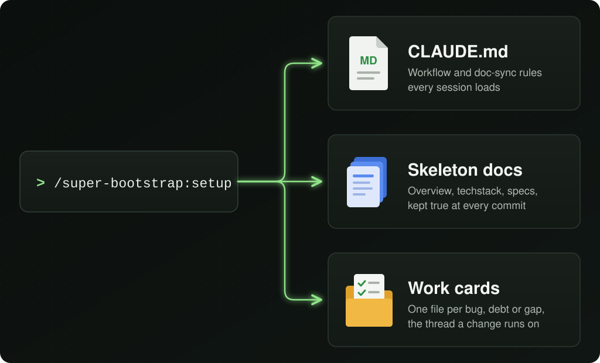
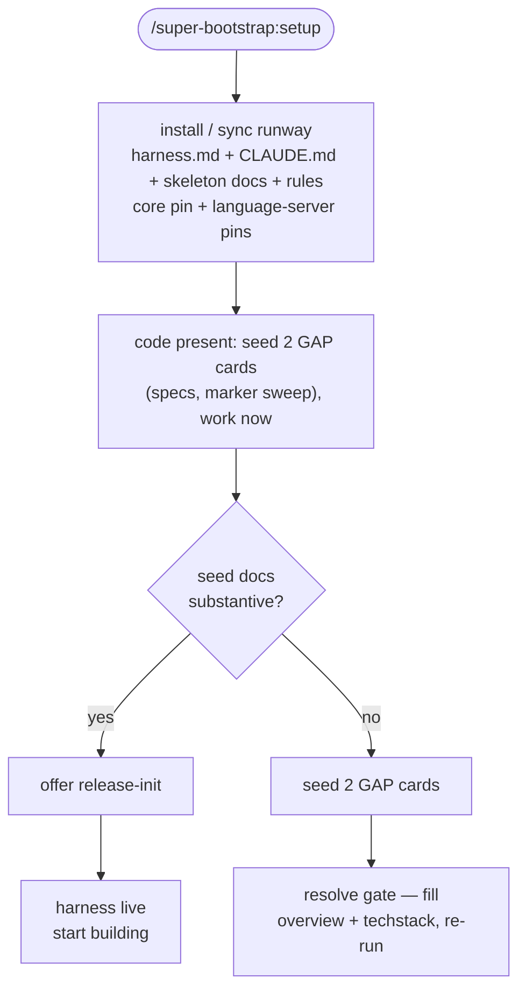

# super-bootstrap



Skip the per-project Claude setup grind. One command writes `CLAUDE.md`, seeds skeleton docs, pins your config, **and gives Claude a phase-gated workflow** — every session runs the pipeline, but only the phases the work actually needs. Workflow, not just a toolbelt. The harness [names disciplines, not skills](docs/specs/harness-architecture.md#6-decided-vs-open), so it does not marry you to any one process-harness plugin.

## Best for

Solo devs juggling multiple repos — agentic builders, not just coders. The harness carries
product context (problem, user, gap cards) alongside the engineering pipeline, because a
[codebase answers *solution* only](docs/overview.md#user).

## Install

In Claude Code:

```
/plugin marketplace add rockyhong/super-bootstrap
/plugin install super-bootstrap@super-bootstrap
```

A repo that `/super-bootstrap:setup` has run in commits a pin for this plugin. The pin declares the plugin; it does not install it — on another machine, run the install above once.

### Cloud sessions

A cloud session (Claude Code on the web) loads none of the plugins a repo's `.claude/settings.json` declares — so the [core pin](docs/techstack.md#key-dependencies) `/super-bootstrap:setup` writes doesn't reach it, and `/plugin` isn't available there. Install the plugin from the cloud environment's setup script instead: on claude.ai/code, select the cloud icon above the message box, hover your environment, open its settings (gear), and put this in the **Setup script** field (not *Environment variables*):

```bash
#!/bin/bash
claude plugin marketplace add RockyHong/super-bootstrap || true
claude plugin install super-bootstrap@super-bootstrap || true
exit 0
```

The setup script belongs to the environment, not the repo — set it once and every repo opened in that environment gets the plugin. It runs only when a new session starts, so open a new session after saving.

## Use

```
/super-bootstrap:setup
```

One command per repo. Auto-routes:

The runway installs or syncs first either way — [no product Q&A at any point](docs/overview.md#problem). What follows depends on whether the seed docs already carry product content:

- **Code present** → first seeds two GAP cards (feature specs, code-marker sweep), commits them, and works what it can in the same run — an interrupted run leaves the cards for cold pickup.
- **Seed docs substantive** → offers [`release-init`](plugins/super-bootstrap/skills/release-init/SKILL.md) for repos that ship versioned releases.
- **Seed docs unfilled (greenfield)** → seeds two GAP cards (overview, techstack) and stops at the resolve gate; the language-server pin waits until `docs/techstack.md` names the stack.

The runway pins the language-server plugin your `docs/techstack.md` names (a static language → `*-lsp@claude-plugins-official` table) and prints the server binary's install command for each pin it inserts. It skips a pin your user-scope `~/.claude/settings.json` sets `false`, or covers with an enabled variant whose name starts with the pin's name (`typescript-lsp-win@local`), and prints one line per skipped pin.



Re-run any time — incremental, never overwrites your edits; when a plugin-owned file placed in your repo (`.claude/rules/harness.md`, the three hook scripts) no longer matches the copy the installed plugin ships, every session opens with a one-line advisory naming the files and the re-run ([`runway-drift`](plugins/super-bootstrap/hooks/runway-drift.sh), a plugin-owned SessionStart hook — nothing placed in your repo); in a repo still in the pre-split shape, that hook's one line names the re-run as the migration. A re-run also retires consumer fork skills/agents the plugin now supersedes (per-deletion confirm) and backfills runway sections added since the last sync; stack facts (the `CLAUDE.md` Tech Stack line, `docs/techstack.md`'s Runtime / Framework / Key Dependencies / Build & Distribution) are seeded once — a re-run after code first arrives flags them stale for a hand refresh, never rewrites them. A workspace manifest (`pnpm-workspace.yaml`, `turbo.json`, …) switches on the monorepo tier — rules and build pre-flight fan out per package. Repos whose card set outgrows one flat list can opt into the scale module (`docs/parked.md` + `docs/test-queue.md` + `docs/outward/`) — offered only once earned, never by default.

### Upgrading a repo whose `CLAUDE.md` holds the workflow sections

Before v7 the workflow doctrine lived in your `CLAUDE.md`. It now lives in `.claude/rules/harness.md`, a file the plugin owns whole. Update the plugin, then in each repo:

1. Run `/super-bootstrap:harness-bootstrap`. The run is the migration and nothing else. It sorts every line of the old `CLAUDE.md` — moved to the doctrine file, dropped as old plugin text, or kept as your own addition — and prints the list.
2. Read the list and answer `y`. Nothing is written before that. A kept line that is really old plugin text, or the reverse: say so at this step and the list is rebuilt.
3. Run `/super-bootstrap:harness-bootstrap` once more for the regular sync.

The migration lands as one commit; `git revert <sha>` undoes it. Sorting the lines is the agent's judgment and differs run to run — your confirm and four checks the run makes before it commits (the placed file equals the shipped one, no workflow heading left in `CLAUDE.md`, every old line kept or on the drop list you saw, no new broken link) are the floor.

Report it as an issue on [the plugin's repo](https://github.com/rockyhong/super-bootstrap/issues) when a migration does any of these: an old line is in neither new file nor on the drop list you saw; old plugin text is kept as your own line; one of the four checks fails, or the run stops on a case it does not cover; the regular sync after it asks section by section again.

A repo you never re-run keeps working: every skill reads the doctrine in either place. Update the plugin on each device before you re-run there — an older plugin reads a migrated repo as missing its workflow sections and proposes to insert them back.

## How files are handled

| Path | Behavior |
|---|---|
| `.claude/rules/harness.md` | **Plugin-owned, whole file** — the workflow doctrine (pipeline, dispatch, doc sync, git), loaded every session with no `paths:` filter. A re-run re-places it from the installed plugin: silently when your copy is the one last placed, with an overwrite-or-keep prompt when it was edited by hand. Put your own additions in `CLAUDE.md`. |
| `CLAUDE.md` | **Yours** — seeded once with the project sections (Rules, Tech Stack, Commands, Planning) when the repo has none; never diffed or overwritten after. A re-run writes only the index line of a rule file or doc a sync-report row names: it appends one for a file it newly places, re-points or drops one for a file it moves or retires, and rewrites a placed doc rule's fires-on list when it no longer matches the rule's shipped `paths:` entries and you approve that bullet's row (every re-run compares it, whether or not the rule file changed). A repo whose `CLAUDE.md` still holds the workflow sections and has no `.claude/rules/harness.md` is in the pre-split shape: the re-run migrates it. It lists what moves to the doctrine file, what is dropped as old plugin text and what stays as your own additions, writes only on your confirm, and lands the move as one commit that one `git revert` undoes; run it once more for the regular sync. |
| `.claude/settings.json` | **Merged** — adds `enabledPlugins` + `extraKnownMarketplaces` for the [core self-pin](docs/techstack.md#key-dependencies), plus the language-server pins your `docs/techstack.md` names (inserted when missing, never removed; skipped when your user-scope `~/.claude/settings.json` sets the key `false` or enables a same-name variant; a pin you delete after a sync stays deleted); your other settings preserved. |
| `CODING_STANDARDS.md` | **Seeded** headings-only at the repo root when the repo has code — your repo's binding conventions, read at every code touch; a docs-only repo (no manifest, no source file) takes no file until code arrives (the line that sends Claude to it ships in `.claude/rules/harness.md` and reads the file only where one exists). Preamble + section headings drift-checked on re-run; section content is yours, hand-recorded when a review or commit settles a convention (this file sits outside the doc-sync surface). |
| `docs/`, `.claude/rules/` | **Seeded** with new files from detected stack, plus two always-placed doc-authoring rules (`ssot-doc-link`, `dimension-discipline`) whose shipped bodies are drift-checked on re-run. User-grown content never touched on re-run. |
| `docs/extensions.md` | **Yours** — never seeded, never drift-checked ([project-owned](plugins/super-bootstrap/skills/harness-bootstrap/SKILL.md#phase-2-scaffold--sync)). Create it to add fields to cards, parked entries, or outward threads; each container's contract points to it. |
| `.claude/hooks/` | **Installed** by default — three hook assets: `commit-channel` (PreToolUse, on both the Bash and PowerShell tools) confines `git commit`, `git merge --continue` and `git rebase --continue` to the main-session commit door — worker subagents are routed back to `/super-bootstrap:commit`, which runs commit mechanics gateway-inline, runs two bundled whole-surface checks every commit — link integrity, and restated agent model pins against their frontmatter — judges doc-sync warm-inline at or under the scope ceiling and through a cold doc-sync scan above it, and dispatches a premise-closure judge on a product-anchor hit. The `consult-check` pair (SessionStart + UserPromptSubmit) derives a compact `docs/**` catalog once per session and injects a forced per-doc relevance evaluation at every prompt — the read boundary's activation layer. |
| `.claude/super-bootstrap-runway.json` | **Coverage receipt** — records the plugin version that scaffolded/synced this runway plus what that sync actually checked — the sections and whole-file artifacts it compared or proposed for insert, and the renamed-away literals its rot scan raised (`covered` / `declined`; each declined row carries [the one-line reason given when it was declined](plugins/super-bootstrap/skills/harness-bootstrap/SKILL.md#2c-sync-report--commit), plus an anchor hash of the template text it was declined against; on the next re-run an unchanged anchor carries the decline without a prompt, and a changed one re-prompts with the reason shown) — and, per frozen file asset it placed or verified current, the sha256 of the asset (`placed`), so a later sync can tell a lagging copy from a consumer-edited one. The version is recorded, never compared: a re-run decides by the files present. |
| `.env*`, `*.key`, `*credential*` | **Skipped** from scan entirely — never read, never written. |

## Day to day

The runway's doors are bundled skills — all namespaced `super-bootstrap:`, entry included: `/super-bootstrap:setup`. Work enters as a card in `docs/work/` ([`BUG` / `DEBT` / `GAP`](docs/work/README.md#categories)) and runs one envelope — ground → implement → verify → doc-sync → commit — with only the phases the card's shape needs. Most doors Claude reaches on its own; you type five daily, two when the moment calls.

**You type**

| Door | Role |
|---|---|
| `/super-bootstrap:log <observation>` | Capture — writes a card; feature ideas log as `GAP` beside defects. Suspected duplicates surface for your pick, never auto-merge. |
| `/super-bootstrap:needs-me` | What deserves your attention — cuts the open work into lenses that exist in your repo right now, asks which, recommends up to five items with why they need you. Session opener for design / decision work. |
| `/super-bootstrap:session-close` | At a session boundary — done-close clears your carry; park-close appends a `## Progress` block to the card and writes only the rest to the `SESSION-STATE/` ledger. Commits land in flow, so the close catches what was left uncommitted. Every closeout move (that commit through the commit door, card resolve, prune, and a push where the repo has a remote) and each of the door's returns runs through one confirm-pick, so the close asks nothing after it. Work the session took on and left undone — a card it logged and left open, a task it promised — asks in that same pick: finish it now (the close pauses), park it, or leave it open. |
| `/super-bootstrap:session-continue` | Session opener for resuming — reads the `SESSION-STATE/` ledger, claims the carry you pick, reads its card's latest block of each type, confirms the next step. No carry → hands off to `needs-me`. |
| `/super-bootstrap:help` | Index of installed user-invoke skills, grouped by category. |
| `/super-bootstrap:autorun` | Runs the cards that need no one — one isolated git worktree + headless `claude -p` per card, each running the whole card to done; incidental harness edits come back on the card for the gateway to apply after the merge; walls come back as one sheet with resolve / park / drop. User-only by design. |
| `/super-bootstrap:merge` | When feature branches are ready — absorbs them; several branches land through one integration branch with one verify and one doc-sync; aborts + surfaces the file list on conflict. |

**Claude runs** — reached by the pipeline, not typed (typing them works; you rarely need to)

| Door | When |
|---|---|
| `/super-bootstrap:triage {ID}` | Every card pickup — a cold, read-only subagent verifies the card's premise and appends a Verdict block; no code changes. |
| `/super-bootstrap:commit` | End of every cycle — session-isolated (never `-A`, never the shared index — `git commit -o` by pathspec, a private index for a file mixed with another writer's hunks; what commits is read back against the session list, and an optional consumer-declared verify runs on the tree that commits), link-integrity and model-pin checks every commit, doc-sync judged on a [mechanical gate hit](plugins/super-bootstrap/skills/commit/SKILL.md) — warm gateway-inline at or under the scope ceiling, by a cold scan dispatch above it. The `commit-channel` hook routes a worker subagent's `git commit`, `git merge --continue` or `git rebase --continue` back here. |
| `/super-bootstrap:triage-report` | When a scan report lands in `.review/` — per-finding promote / patch / dup / investigate / dismiss. |

Per-skill contract = that skill's `SKILL.md` frontmatter; one-line index in the [plugin README](plugins/super-bootstrap/README.md#skill-catalog); pipeline shape in [`docs/overview.md` § Data Flow](docs/overview.md#data-flow).

## Occasional

Not day-to-day — run when the moment calls:

- `/super-bootstrap:check-docs-consistency` — whole-surface doc drift scan, timestamped report to `.review/`, report-only; the commit door's scoped scan covers the everyday case. User-only by design.
- `/super-bootstrap:release-init` — one-shot scaffolder. Detects project type (unity / tauri / node / ios-native / android-native / generic) and generates a tailored `/release` skill at `.claude/skills/release/SKILL.md` (project-level skill, bare invocation since it lives in the user's repo, not under this plugin's namespace). Run only on repos that ship versioned releases.

## Other tools

A repo adds a process harness through Claude Code's own plugin install; no plugin door routes it. For stack-matched skill / MCP / hook recommendations, run `claude-code-setup:claude-automation-recommender`.

## License

MIT
